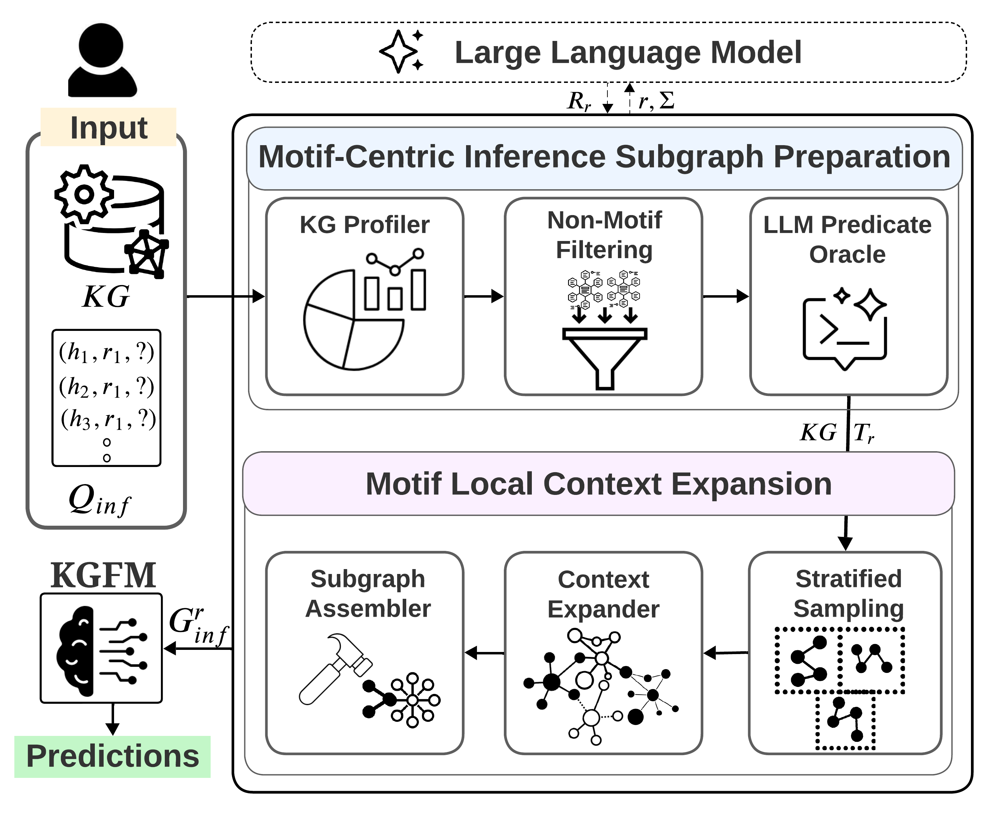

# KG-CORE
<p align="center">
  
</p>
**Knowledge Graph Context and Representative-Example Subgraph Sampler**
\
Knowledge graph foundation models (KGFMs) eliminate training a new model for every KG and task. A pretrained KGFM answers link prediction queries over an unseen KG, provided to the model as an inference graph. The KGFM reasons over the transferable relational patterns in this graph, known as motifs. The inference graph is the model's only source of the KG structure and semantics, and its quality determines both prediction accuracy and inference cost. Real KGs contain many irrelevant predicates and non-motif structures, which dilute the task-relevant motifs and mislead the KGFM. Standard KGFM inference loads the entire KG into memory, so it fails with out-of-memory errors on large KGs and incurs high latency. Topology-based sampling is semantically blind, so its reduced graphs retain this noise. Sampling methods designed for training approximate gradients provide no representative examples for zero-shot inference. We propose KG-CORE, a modular framework that constructs a compact motif-centric inference subgraph per query. KG-CORE filters non-motif and irrelevant predicates using statistical profiling and LLM-guided selection. It then combines representative in-context examples with bounded multi-hop expansion around the query entities. We evaluate KG-CORE on three real KGs of up to 118M triples, one to two orders of magnitude larger than existing KGFM benchmarks. KG-CORE matches or exceeds full-KG Hits@10 across three state-of-the-art KGFMs: ULTRA, MOTIF, and FLOCK. It reduces memory by up to 97% and inference time by up to 50X. It enables inference where full-KG inference fails. KG-CORE is model-agnostic, uses one fixed configuration across all KGs and tasks, and requires no retraining.
A direction-aware, LLM-guided pipeline for task-specific subgraph extraction, targeting tail prediction (h, r, ?) in Graph Foundation Models (GFMs).

---

## Overview

Rather than feeding a full knowledge graph to a GFM, KG-CORE extracts a compact, semantically focused subgraph that combines:

- **Representative in-context examples**: stratified, degree-aware samples for each inference predicate.
- **Structural neighborhood**: directional multi-hop BFS from query entities.
- **Oracle-guided predicate filtering**: LLM-selected predicates restrict the search space to relations relevant to the inference task.

---

## Repository Structure

```
KG-CORE/
├── run_kgcore.py              # Entry point
├── configs/
│   └── default.yaml           # All hyperparameters documented
└── kg_core/
    ├── __init__.py
    ├── args.py                # CLI flags + output path builder
    ├── pipeline.py            # Orchestrator (wires filtering–construction)
    ├── profiling/
    │   └── profiler.py        #  · KG Profiler
    ├── filtering/
    │   ├── motif_denoising.py #  · Non-Motif Filtering + early-exit modes
    │   └── predicate_oracle.py#  · LLM Predicate Oracle
    ├── construction/
    │   ├── sampler.py         #  · Stratified Sampler
    │   ├── expander.py        #  · Context Expander
    │   └── assembler.py       #  · Subgraph Assembler
    └── utils/
        ├── io.py              # save_triples
        └── logging.py         # log_performance
```

---


## Installation
```bash
pip install pandas tqdm
# For live LLM oracle:
pip install openai
```

---

## Usage

```bash
# Full pipeline with LLM oracle (static file)
python run.py \
    --path_train /data/train_FG.txt \
    --path_test  /data/test.txt \
    --path_llm_preds /data/llm_preds.txt \
    --use_LLM \
    --direction both \
    --hops 1

# Context-only (no stratified sampling)
python run.py \
    --path_train /data/train_FG.txt \
    --path_test  /data/test.txt \
    --no_sampling

# Early-exit diagnostic modes
python run.py --path_train /data/train_FG.txt --path_test /data/test.txt \
    --filter_mode literal_only

python run.py --path_train /data/train_FG.txt --path_test /data/test.txt \
    --filter_mode llm_only --use_LLM
```

---

## Key Hyperparameters

| Flag | Default | Description |
|---|---|---|
| `--beta` | 0.5 | Tail-distribution smoothing (0=uniform, 1=proportional) |
| `--degree_alpha` | 0.5 | Inverse-degree weighting for node sampling |
| `--direction` | both | BFS direction: `outgoing` / `incoming` / `both` |
| `--hops` | 1 | BFS expansion depth |
| `--min_per_label` | 4 | Minimum examples per tail-entity class |
| `--max_label_ratio` | 100 | Soft upper cap on per-label sample count |
| `--literal_threshold` | 0.9 | Uniqueness ratio threshold for literal detection |
| `--numeric_threshold` | 0.9 | Numeric prevalence threshold |

---

## Ablation Conditions

KG-CORE's modular design directly supports the ablation table:

| Ablation | Flag |
|---|---|
| Disable stratified sampling | `--no_sampling` |
| Single-hop context only | `--hops 1` |
| Outgoing traversal only | `--direction outgoing` |
| No LLM oracle | omit `--use_LLM` |

---

## LLM Oracle: Live Mode

To switch from static predicate files to live LLM querying, replace the call in `pipeline.py`:

```python
# Current (static file)
oracle = LLMPredicateOracle.from_file(path_llm_preds)

# Live mode (requires OPENAI_API_KEY)
oracle = LLMPredicateOracle.from_llm(
    profile=profile,
    test_predicate=list(inf_predicates)[0],
    top_k=20,
)
```

The oracle prompt supplies `train['p'].value_counts()` and the target predicate `r`, asking the model to return the top-k structurally relevant relations.
